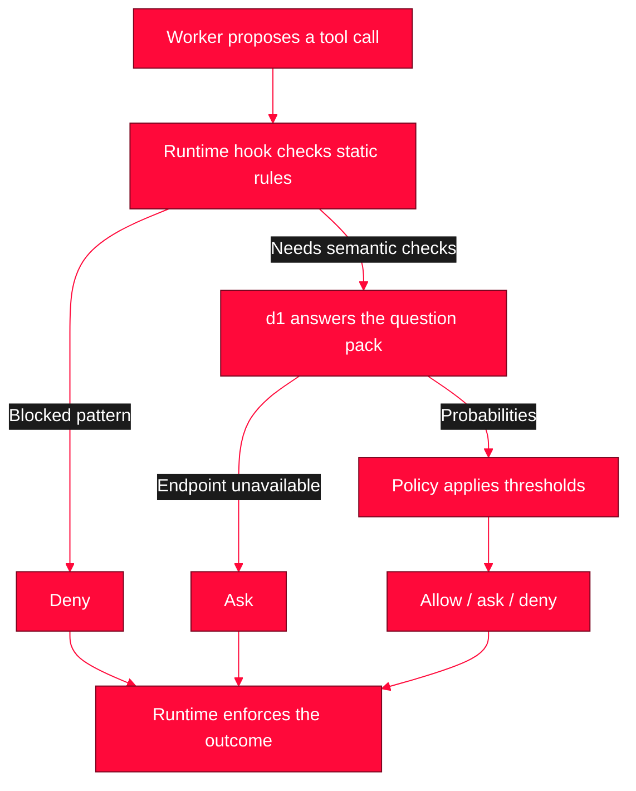

<div align="center">


# Fluid Decisions

**Safety classification, routing, tool gating and verification for coding agents and agentic workers.**


[The MVP](#what-it-does) · [How it works](#how-it-works) · [Self-hosting](#how-to-start) · [Roadmap](#roadmap) · [Project documents](#project-documents)

</div>

---

> [!NOTE]
> **MVP with IP-003 result handling.** The Python library, CLI, runtime hook, MCP server and optional model download/serving tools are implemented. Unscored results are distinguished from flags, carried forward as pending taint, and can be rechecked. Policies are **uncalibrated**. See the [result-handling report](docs/c-completion_reports/CR-003_Unscored_Results.md) for live evidence and limitations. IDEA-001 and IDEA-002 remain the roadmap.
>
> Since then, every model call is budgeted from a measured cost model (IP-005), and a model-free provenance floor denies or asks a later call that carries a command span or secret value from an earlier result. As of IP-007 the **facts gate is the default** (`gate.yaml`): small facts over small states, a two-stage unit post-result check, read-only axis zeroing, proportionate `carries_out` taint instead of a blanket floor, a withheld-path re-read denial, turn-boundary recheck of unscored results, and release of a confirmed result with the offending unit redacted. The frozen flat pack is the fallback (`FD_GATE_PACK=gate-packet`). Pack lines are calibrated against an explicit false-flag budget; `taint_carry_line` is uncalibrated pending the confirmation arm. See the [usage guide](docs/USAGE.md#the-facts-gate-and-its-taint-behaviours-ip-006ip-007).

<a name="overview"></a>
## 

Fluid Decisions is a self-hosted decision layer around Liquid AI's d1 models. It helps an agent check what it is about to do, choose where work should go, and verify its claims against supplied evidence.

The design separates three responsibilities: **the worker proposes, d1 returns probabilities, and policy code decides what happens next.** A runtime hook enforces the checks around tool execution. The worker's willingness to call a checking tool is not the enforcement mechanism.

The longer-term ambition is a reusable layer for checking agent behaviour, documents and proposed decisions against explicit rules. The first milestone is deliberately focused: prove classification, routing, gating and verification, then build on measured results.

<a name="what-it-does"></a>
## 

### The MVP: four jobs, one policy layer

| Job | What it does | Example |
| --- | --- | --- |
| **Classify** | Check code, documents or screenshots against a named set of questions, with probabilities attached to each finding. | Flag code that appears to steal credentials or conceal build-time behaviour. |
| **Route** | Choose among defined destinations, alongside escalation and completeness checks. | Send a ticket to the right queue, or select a local model, a reasoner or a human. |
| **Gate** | Check a proposed tool call before execution and return **allow**, **ask** or **deny**. | Block a destructive shell pattern even when the model endpoint is unavailable. |
| **Verify** | Check claims in a finished answer against the supplied source and flag unsupported claims. | Catch an answer that contradicts a source without inventing a replacement sentence. |

One Python library supports a CLI, runtime hooks and a thin MCP server. The hook uses a [documented stdin JSON contract](docs/USAGE.md#runtime-hook-and-mandatory-enforcement). MCP exposes the same capabilities to workers that cannot install a hook; mandatory enforcement requires the host runtime to wire the checks into its workflow. The supplied `GuardedRuntime` wraps tool dispatch and withholds flagged results.

An unscored result is released with `checked: false` by default, and its uncertainty is carried to the next action through pending session taint; operators can select withholding instead.

The MVP also includes versioned YAML question packs and policies, a session ledger for flagged and pending results, and an audit log of verdicts, probabilities, lane, pack version and latency. Raw input state stays out of the audit log by default.

### How the small decision lane compares to a chat-model judge

In an external [AgentDojo comparison](docs/c-completion_reports/CR-008_AgentDojo_Comparison.md), the d1-lane guard was measured against an **independent chat-model judge** (`claude-haiku-5-5`) scoring the same tool calls and results under the same policy, pooled over two live runs. On blocking the prompt-injection attack the two were close: **1 of 10 attacked episodes slipped under the guard, 0 of 10 under the judge**. But the small decision lane did it **two to three times faster per scorer call**, with **seven to seventeen times fewer tokens** and six to ten times fewer scorer calls — and it **kept the user's task in 8 of 10 attacked episodes versus the judge's 5 of 10**, because it redacts only the injected unit rather than discarding the whole tool result. Indicative on a small slice, not a settled ranking; the numbers and caveats are in CR-008.

Reading past the measurement (an inference, not a measured result): `claude-haiku-5-5` is a fast, capable cloud classifier backed by Anthropic's own safety tuning, and a self-hoster can't run it privately. The realistic self-hosted alternative to the decision lane is a *local* general LLM used as a judge, which — being far larger than a 3B decision model — would be slower than it, and, without comparable safety tuning, is unlikely to be safer than Haiku. That a ~3B local decision model held close to Haiku on blocking while costing far less and keeping more of the task therefore suggests d1 is a strong local guard relative to a self-hosted LLM classifier. This is not directly measured here; a local-LLM-judge arm is future work.

The full scope and acceptance criteria are in [IP-001: the kickoff plan](docs/b-implementation_plans/IP-001-KICKOFF.md).

<a name="how-it-works"></a>
## 

d1 answers typed questions over a state: **choice** selects among named options, **score** rates ordered levels, and **noul** gives the probability of yes. Related questions share one request; the optional IP-004 scoping mechanism can give a question a selected dotted-path view of the state and reports unresolved views instead of allowing a missing answer. The measured candidates failed adoption criteria, so the shipped packs remain unscoped. Policy code then applies rules and thresholds to the returned probabilities. See the [d1 reference skill](skills/liquid-d1/SKILL.md) for the API background.

The tool-gating path is:



The MVP controls are:

- **Static rules run first.** Known destructive patterns do not need a model verdict.
- **Unavailable means ask.** An endpoint failure or timeout cannot become permission to proceed.
- **Probabilities remain visible.** Full distributions, confidence and yes/no decisiveness stay distinct so callers can see uncertainty.
- **Some risks cannot be softened.** Authorisation or a user request cannot override secret exposure, constraint violations or unresolved choices.
- **Calibration follows evidence.** Initial thresholds are explicitly uncalibrated. An allow verdict is a policy outcome, not proof that arbitrary code is safe.
- **Every model call is budgeted.** Each check's time budget is derived from the lane's measured cost, so a large tool input completes instead of timing out to ask; a call whose expected cost exceeds the configured cap returns ask without being sent. Static denials run first and never wait on a budget.

After a tool returns, the hook checks its output for injection or canary content and retains session flags for later gates. Verification of a finished answer must likewise be triggered by the host workflow.

<a name="how-to-start"></a>
## 

### Built for community self-hosting

The setup is **download a model → start its decision API → configure Fluid Decisions → connect a worker**. Follow the [self-hosting guide](docs/SELF_HOSTING.md) for the complete path and [usage guide](docs/USAGE.md) for the CLI, hooks and MCP.

| Model | Role | Upstream |
| --- | --- | --- |
| **d1-3B** | Default for text and image workflows. The core workflow can run with this model alone. | [Model and loading instructions](https://huggingface.co/LiquidAI/d1-3B) |
| **d1-omni-600M** | A smaller (~0.6B) multimodal decision model: the same system-one decision task as d1-3B over text and images, **plus audio**, for when a smaller memory footprint matters. The client routes audio here because d1-3B is text and image only; image and audio stay in separate requests (a combined request is rejected). | [Model and loading instructions](https://huggingface.co/LiquidAI/d1-omni-600M) |

Serve the models on your own hardware or connect to compatible endpoints you control. Public defaults use localhost. The client, CLI, hook and MCP have no PyTorch dependency; install the optional `serve` extra in the model-serving environment.

```sh
git clone https://github.com/abliter8-ai/fluid-decisions.git
cd fluid-decisions
python3 -m venv .venv
.venv/bin/python -m pip install '.[serve,mcp]'
.venv/bin/python scripts/download_models.py d1-3B --local-dir models
.venv/bin/python scripts/serve_model.py --model d1-3B --model-path models/d1-3B
```

In another terminal, from the same directory:

```sh
.venv/bin/fluid gate --tool read_file --input '{"path":"README.md"}' \
  --user-request 'Read the README'
```

The model server stays in the first terminal. Model loading executes the pinned upstream custom code; read the model licence links below. The guide covers optional audio, device selection and timeout configuration for slower hardware.

The repository adapter has been tested with d1-3B revision `051bcc464b01b9f92942b364d9586b0ef5912432` on macOS 26.5 / Apple Silicon MPS / Python 3.14.8. Its text, image, batch and tool workflows passed in a bounded local run; see [self-hosting validation](docs/SELF_HOSTING.md#validation-status). Other platforms and local omni serving remain untested.

Development uses the maintainer's cluster and gateway. Community users need no access to either. Recorded checks cover the decision lanes and real Qwen/GLM worker calls; separate self-hosting evidence identifies the tested model revisions and environment.

### Use it with a harness

The guard runs as a drop-in proxy in front of an unmodified OpenAI-compatible agent. Install, start `fluid proxy`, and point the harness at the loopback address — three commands:

```sh
.venv/bin/python -m pip install .                      # or: pip install the built wheel
TEST_API_ENDPOINT=<gateway-base-url> TEST_API_KEY=<key> FD_MAX_URL=<d1-text-lane-url> \
  .venv/bin/fluid proxy --listen 127.0.0.1:8765 --workdir "$PWD" --log-args
# point any OpenAI-compatible harness at http://127.0.0.1:8765/v1 with any key
```

The proxy forwards each request to the upstream gateway (`TEST_API_ENDPOINT`/`TEST_API_KEY`) and applies the guard on the way through, scoring against the d1 text lane (`FD_MAX_URL`): it checks every tool **result** with post-result (redacting a confirmed injected instruction, withholding a flagged one) and gates every returned tool **call**, removing a refused one and letting the agent recover. It binds loopback only. For [OpenCode](https://opencode.ai), the provider stanza is:

```json
{
  "$schema": "https://opencode.ai/config.json",
  "provider": {
    "fluid": {
      "npm": "@ai-sdk/openai-compatible",
      "name": "Fluid Proxy",
      "options": { "baseURL": "http://127.0.0.1:8765/v1", "apiKey": "local-proxy" },
      "models": { "<your-agent-model-id>": { "name": "agent via fluid" } }
    }
  }
}
```

A ready-to-run container recipe is in [`harness/proxy-container/`](harness/proxy-container/) (both the proxy and the harness in one container; use `--network host` when the gateway and lane are only reachable on your own network, since the proxy still binds loopback inside the container). What the proxy does to tool calls and results, proven end to end against a local model, is recorded in [CR-010](docs/c-completion_reports/CR-010-USABLE-PROXY.md).

<a name="roadmap"></a>
## Roadmap

**v0.1.0** ships the four jobs and one policy layer, the session ledger with proportionate taint and provenance, the constraints and document-validity checks, file-ownership gating for deletes, and the `fluid proxy` surface, with every threshold marked **uncalibrated**. The next line is calibration from real proxy sessions (see [CHANGELOG.md](CHANGELOG.md)); the directions below are a longer backlog.

The following directions come from the two idea documents. They are an ambition and a backlog, not shipped features or a release schedule. Work on them starts after the MVP is accepted, with each selected idea getting its own implementation plan.

### IDEA-001: deeper checks around agent workflows

[IDEA-001](docs/a-ideas/IDEA-001.md) expands the first four jobs into the surrounding agent session. The MVP establishes the initial ledger, audit trail and uncertainty handling; the roadmap develops those foundations into broader workflows.

| Direction | Where we hope to get |
| --- | --- |
| **Context retention and session memory** | Keep relevant tool traffic verbatim when compacting a session, and make flagged untrusted content visible across later actions. |
| **More useful findings and CI checks** | Turn uncertain classifications into focused second passes with a useful location, then apply the same checks to diffs and source trees. |
| **Model cascades and spoken intent** | Route work among local models, larger reasoners and people; explore direct intent routing for short voice clips. |
| **Visual workflows** | Choose among legal actions on a screenshot and inspect images for explicitly defined defects or regressions. |
| **Verification at completion** | Attach claim-level source checks when an answer is finished, as part of the runtime's delivery workflow. |
| **Calibration from real use** | Fit thresholds by action class and study disagreement between models as a signal of uncertainty, without averaging their probabilities. |

Context compaction is the first proposed expansion. It preserves retained text verbatim. Later priorities depend on observed reliability and useful audit traces.

### IDEA-002: checks over candidates, documents and rules

[IDEA-002](docs/a-ideas/IDEA-002.md) applies the same machinery to work beyond coding agents. A caller supplies a proposed outcome and the rules or evidence to assess it against.

| Direction | What the check would do | Status |
| --- | --- | --- |
| **Candidate constraints** | Check a proposed assignment or plan against supplied constraints, such as capacity, rest periods or time windows. | **Shipped (IP-009)**: `fluid constraints`, returns per-constraint probabilities and a `pass` / `no_feasible_candidate` / `ask` verdict; no fix is proposed. |
| **Document validity** | Check whether a packet is complete and internally consistent. Support of its claims by its sources stays the separate `verify` job. | **Shipped (IP-009)**: `fluid validity`, returns per-check probabilities, a document type with an explicit unknown, a completeness level, and a `valid` / `invalid` / `ask` / `abstain` verdict. Validity is not support. |
| **Least-worst routes** | Compare a shortlist of already feasible, costed paths against explicit trade-offs. A router or solver produces the candidates. | Roadmap |
| **Employment-rule checks** | Flag possible conflicts between a rota, record or deduction and the supplied policy or contract for human review. | Roadmap |
| **Entitlement evidence checks** | Identify complete, incomplete or conflicting evidence against supplied rules, with a person owning the decision. | Roadmap |

These proposals assess candidates and evidence; they do not create schedules, solve routes or establish that a source is true. Employment and entitlement checks would remain review aids, with no autonomous hiring, dismissal, payment or benefit decisions.

The proposed order started with document validity and candidate constraints (both shipped in IP-009), followed by route comparison. Employment and entitlement ideas come later, after calibration and review procedures are established. The shipped lines are uncalibrated, like every other first version.

<a name="project-documents"></a>
## Project documents

| Document | Purpose |
| --- | --- |
| [IP-001](docs/b-implementation_plans/IP-001-KICKOFF.md) | MVP scope, build order and acceptance criteria |
| [Completion report](docs/c-completion_reports/CR-001_Fluid_Decisions.md) | Validation evidence and remaining limitations |
| [IP-002](docs/b-implementation_plans/IP-002-HARDENING.md) / [CR-002](docs/c-completion_reports/CR-002_Gate_Hardening.md) | Gate hardening, session recovery and real adapter validation |
| [IP-003](docs/b-implementation_plans/IP-003-UNSCORED-RESULTS.md) / [CR-003](docs/c-completion_reports/CR-003_Unscored_Results.md) | Unscored releases, pending taint, recheck and measured budgets |
| [Self-hosting](docs/SELF_HOSTING.md) | Download, serve and test your own models |
| [Usage](docs/USAGE.md) | CLI, Python runtime, hook and MCP contracts |
| [IDEA-001](docs/a-ideas/IDEA-001.md) | Agent workflow expansion backlog |
| [IDEA-002](docs/a-ideas/IDEA-002.md) | Candidate, document and rules-checking backlog |
| [d1 skill and API reference](skills/liquid-d1/SKILL.md) | Typed questions and response interpretation; live self-hosted responses must be verified during implementation |
| [Agent instructions](AGENTS.md) | Repository working rules and implementation boundaries |

<a name="licence"></a>
## 

This repository is licensed under the **Apache License, Version 2.0** — see [LICENSE](LICENSE) and [NOTICE](NOTICE). You may use, modify, fork and redistribute it, including commercially; the licence asks that you keep the copyright and licence notice and state significant changes. Copyright 2026 Abliter8.

The model checkpoints have their own upstream terms: [d1-3B licence](https://huggingface.co/LiquidAI/d1-3B/blob/main/LICENSE) and [d1-omni-600M licence](https://huggingface.co/LiquidAI/d1-omni-600M/blob/main/LICENSE). Model weights are downloaded separately and are not bundled here, and are not covered by this repository's licence.
